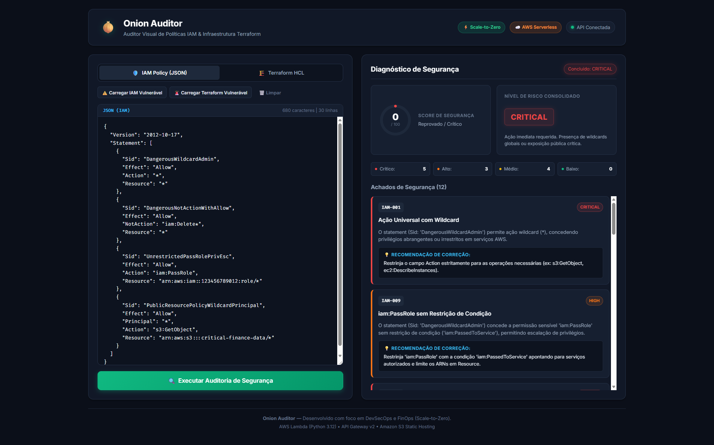
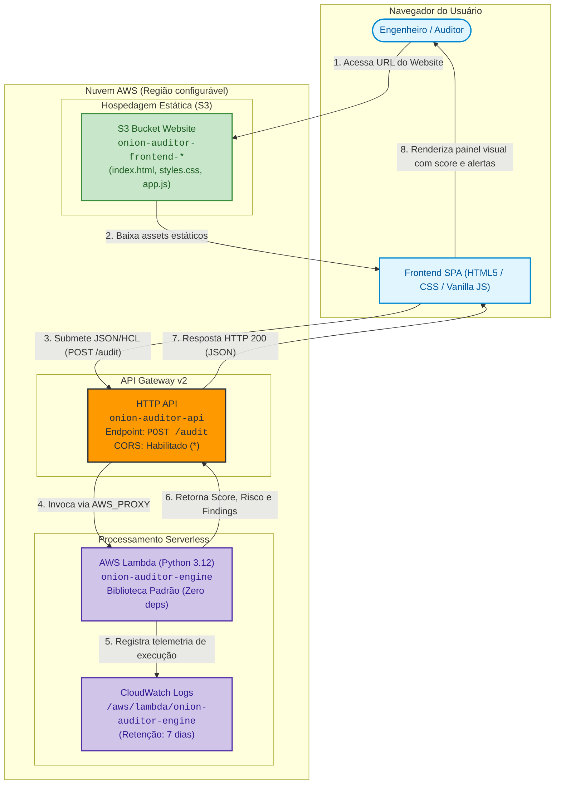

# 🧅 Onion Auditor — Auditor Visual de Políticas IAM & Terraform

[](https://aws.amazon.com/)
[](https://www.python.org/)
[](https://www.terraform.io/)
[](https://www.finops.org/)
[](RELEASE_NOTES_v1.0.0.md)
[](LICENSE)

> [!TIP]
> ### 🚀 Demo ao Vivo
> Acesse a aplicação em execução provisionada na AWS:
> 👉 **[Clique aqui para acessar o Onion Auditor ao Vivo](http://onion-auditor-frontend-654341980060-us-east-2.s3-website.us-east-2.amazonaws.com)**
>
> - **Frontend URL (S3 Static Website):** [http://onion-auditor-frontend-654341980060-us-east-2.s3-website.us-east-2.amazonaws.com](http://onion-auditor-frontend-654341980060-us-east-2.s3-website.us-east-2.amazonaws.com)
> - **API URL (API Gateway v2 + Lambda):** `https://p73sp8ai87.execute-api.us-east-2.amazonaws.com/audit`

[](http://onion-auditor-frontend-654341980060-us-east-2.s3-website.us-east-2.amazonaws.com)

---

## 📌 Sumário
- [🚀 Demo ao Vivo](#-demo-ao-vivo)
- [1. Visão Geral](#1-visão-geral)
- [2. Pilares de Arquitetura & FinOps](#2-pilares-de-arquitetura--finops)
  - [2.1. Matriz de Custos FinOps (Scale-to-Zero)](#21-matriz-de-custos-finops-scale-to-zero)
- [3. Diagrama de Arquitetura](#3-diagrama-de-arquitetura)
- [4. Convenção de Nomenclatura AWS](#4-convenção-de-nomenclatura-aws)
- [5. Estrutura Canônica de Diretórios e Arquivos](#5-estrutura-canônica-de-diretórios-e-arquivos)
- [6. Contrato de API (HTTP API)](#6-contrato-de-api-http-api)
  - [6.1. Endpoint](#61-endpoint)
  - [6.2. Contrato de Entrada (Request)](#62-contrato-de-entrada-request)
  - [6.3. Contrato de Saída (Response)](#63-contrato-de-saída-response)
  - [6.4. Catálogo de Regras de Auditoria](#64-catálogo-de-regras-de-auditoria)
- [7. Segurança, Resiliência & Hardening (v1.0.0)](#7-segurança-resiliência--hardening-v100)
- [8. Outputs Oficiais do Terraform](#8-outputs-oficiais-do-terraform)
- [9. Guia de Operação: Deploy & Destroy](#9-guia-de-operação-deploy--destroy)
  - [9.1. Pré-requisitos](#91-pré-requisitos)
  - [9.2. Deploy Local Passo a Passo](#92-deploy-local-passo-a-passo)
  - [9.3. Pipeline CI/CD (GitHub Actions)](#93-pipeline-cicd-github-actions)
  - [9.4. Destroy & Desprovisionamento Completo (FinOps Clean)](#94-destroy--desprovisionamento-completo-finops-clean)
- [10. Licença](#10-licença)

---

## 1. Visão Geral

O **Onion Auditor** é uma solução Serverless nativa da AWS projetada para atuar como um **Auditor Visual de Políticas IAM e Infraestrutura como Código (Terraform HCL)**. O sistema permite que desenvolvedores, engenheiros DevOps e times de segurança analisem instantaneamente políticas de segurança e trechos de manifestos Terraform, recebendo:

- **Score de Segurança (0 a 100)**: Pontuação de conformidade com deduções baseadas em severidade.
- **Nível de Risco Consolidado**: Classificação imediata (`LOW`, `MEDIUM`, `HIGH`, `CRITICAL`).
- **Achados Detalhados (Findings)**: Diagnóstico item a item com identificador, descrição e recomendação prática de correção de acordo com as melhores práticas de menor privilégio (*Least Privilege*).

> [!IMPORTANT]
> **Contrato Arquitetural Rígido:** Este documento é a especificação normativa única e imutável para todas as camadas de desenvolvimento do projeto. Nenhuma camada subsequente deve introduzir dependências externas adicionais, alterar nomes de recursos, outputs ou modificar o contrato JSON de entrada/saída.

---

## 2. Pilares de Arquitetura & FinOps

A arquitetura do **Onion Auditor** foi desenhada estritamente sob os conceitos de **DevSecOps** e **FinOps (Scale-to-Zero)**:

1. **Frontend Estático (S3 Static Website Hosting):**
   - Interface web SPA (Single Page Application) desenvolvida em HTML5, CSS3 moderno e Vanilla JavaScript (sem frameworks pesados).
   - Hospedada diretamente em bucket S3 configurado para Static Website.
   - **Custo fixo zero:** Cobrança restrita à capacidade armazenada (< 1 MB) e requisições GET (cobertas pelo AWS Free Tier).

2. **API Gateway HTTP API (v2):**
   - Ponto de entrada REST com rota única `POST /audit`.
   - Suporte nativo a CORS totalmente habilitado para consumo direto pelo frontend.
   - Até 70% mais barato e com menor latência que o API Gateway REST API tradicional.
   - **Scale-to-Zero absoluto:** Não há custos quando não houver requisições.

3. **Motor de Auditoria AWS Lambda (Python 3.12):**
   - Função executada sob demanda sobre arquitetura ARM64 (Graviton2) ou x86_64 com runtime Python 3.12.
   - **Zero Dependências Externas:** Utiliza estritamente a biblioteca padrão do Python (`json`, `re`, `typing`, `dataclasses`, `enum`). Isso elimina o uso de `pip`, remove camadas de build (layers), previne vulnerabilidades em supply chain e garante inicializações a frio (*cold starts*) sub-50ms.
   - Faturamento estritamente por milissegundo de execução.

4. **Observabilidade Otimizada (Amazon CloudWatch Logs):**
   - Grupo de logs com retenção estrita de 7 dias, eliminando custos desnecessários de armazenamento de longo prazo.

### 2.1. Matriz de Custos FinOps (Scale-to-Zero)

O design 100% Serverless garante que o ambiente não possua nenhum custo fixo ou instâncias ociosas ligadas (*idle cost zero*):

| Componente AWS | Camada Gratuita (AWS Free Tier) | Custo em Ociosidade | Custo Estimado (10.000 req/mês) |
| :--- | :--- | :--- | :--- |
| **S3 Static Website** | 5 GB storage padrão, 20.000 requisições GET | **US$ 0.00** | < US$ 0.01 |
| **API Gateway (HTTP API v2)** | 1.000.000 de requisições/mês | **US$ 0.00** | ~ US$ 0.01 |
| **AWS Lambda (Python 3.12)** | 1.000.000 de execuções e 3.2M seg-ARM/mês (Always Free) | **US$ 0.00** | **US$ 0.00** (coberto pelo Free Tier) |
| **CloudWatch Logs** | 5 GB ingestão gratuita, retenção de 7 dias | **US$ 0.00** | **US$ 0.00** (abaixo da cota mínima) |
| **Total Estimado** | — | **US$ 0.00 / mês** | **< US$ 0.02 / mês** |

---

## 3. Diagrama de Arquitetura

O fluxo completo de requisição, análise estática e visualização é ilustrado no diagrama abaixo:



---

## 4. Convenção de Nomenclatura AWS

Todos os recursos criados na AWS devem adotar estritamente o prefixo padrão **`onion-auditor-*`**:

| Recurso AWS | Identificador / Padrão de Nomenclatura | Finalidade |
| :--- | :--- | :--- |
| **S3 Bucket (Frontend)** | `onion-auditor-frontend-<account_id>-<region>` | Armazenamento e distribuição dos arquivos estáticos do frontend via website hosting |
| **API Gateway HTTP API** | `onion-auditor-api` | Ponto de entrada HTTP API com roteamento `POST /audit` |
| **Lambda Function** | `onion-auditor-engine` | Motor de auditoria estática em Python 3.12 |
| **IAM Role (Lambda)** | `onion-auditor-lambda-role` | Perfil de execução assumido pela função Lambda |
| **IAM Policy (Lambda)** | `onion-auditor-lambda-policy` | Permissões de escrita de logs no CloudWatch (`AWSLambdaBasicExecutionRole`) |
| **CloudWatch Log Group**| `/aws/lambda/onion-auditor-engine` | Armazenamento de logs com retenção fixa de 7 dias |

---

## 5. Estrutura Canônica de Diretórios e Arquivos

A árvore de arquivos abaixo representa o layout definitivo e imutável do repositório:

```text
onion-iam-tf-auditor/
├── .github/
│   └── workflows/
│       └── deploy.yml              # Pipeline CI/CD automatizado no GitHub Actions
├── docs/
│   └── screenshot.png              # Captura de tela da aplicação em execução
├── iam/
│   └── lambda-policy.json          # Política de menor privilégio para a função Lambda
├── src/
│   ├── __init__.py                 # Declaração do módulo Python
│   ├── app.py                      # Handler principal AWS Lambda e adaptador HTTP API
│   ├── auditor.py                  # Motor central de regras (IAM + Terraform) e cálculo de score
│   └── test_auditor.py             # Bateria de testes unitários usando apenas unittest
├── terraform/
│   ├── versions.tf                 # Declaração de versões mínimas (Terraform >= 1.5, AWS >= 5.0)
│   ├── variables.tf                # Variáveis de entrada (aws_region, project_prefix, environment)
│   ├── main.tf                     # Provedor AWS, locals e dados da conta
│   ├── s3.tf                       # Provisionamento do bucket S3, website hosting e bucket policy
│   ├── lambda.tf                   # Archive do código Python, função Lambda e permissão de invoke
│   ├── api_gateway.tf              # HTTP API v2, rota POST /audit, stage $default e CORS
│   ├── iam.tf                      # AssumeRole, roles e policies para a Lambda
│   └── outputs.tf                  # Saídas oficiais e contratuais da infraestrutura
├── web/
│   ├── index.html                  # Interface web visual do auditor
│   ├── styles.css                  # Folha de estilos moderna, limpa e responsiva
│   └── app.js                      # Lógica client-side para consumo da API e exibição visual
├── .gitignore                      # Exclusões para Terraform, Python, segredos e temporários
├── LICENSE                         # Licença MIT
└── README.md                       # Contrato arquitetural e documentação oficial
```

---

## 6. Contrato de API (HTTP API)

### 6.1. Endpoint

- **Método HTTP:** `POST`
- **Caminho:** `/audit`
- **Headers Requeridos:**
  - `Content-Type: application/json`
- **CORS:**
  - `Access-Control-Allow-Origin: *`
  - `Access-Control-Allow-Methods: POST, OPTIONS`
  - `Access-Control-Allow-Headers: Content-Type, Authorization`

---

### 6.2. Contrato de Entrada (Request)

O corpo da requisição deve ser um objeto JSON estrito contendo o tipo de análise e a string do conteúdo a ser auditado:

```json
{
  "type": "iam",
  "content": "{\n  \"Version\": \"2012-10-17\",\n  \"Statement\": [\n    {\n      \"Effect\": \"Allow\",\n      \"Action\": \"*\",\n      \"Resource\": \"*\"\n    }\n  ]\n}"
}
```

#### Especificação dos Campos:

| Campo | Tipo | Obrigatório | Valores Permitidos | Descrição |
| :--- | :--- | :--- | :--- | :--- |
| `type` | `string` | **Sim** | `"iam"` \| `"terraform"` | Define o motor de regras que será acionado para validar o payload. |
| `content` | `string` | **Sim** | String não vazia | Conteúdo a ser auditado. No caso de `iam`, string contendo JSON válido de política IAM. No caso de `terraform`, string com código HCL. |

#### Exemplo de Requisição Terraform HCL:

```json
{
  "type": "terraform",
  "content": "resource \"aws_security_group\" \"web\" {\n  name = \"web-sg\"\n  ingress {\n    from_port = 22\n    to_port = 22\n    protocol = \"tcp\"\n    cidr_blocks = [\"0.0.0.0/0\"]\n  }\n}"
}
```

---

### 6.3. Contrato de Saída (Response)

A resposta da API retorna status HTTP `200 OK` (ou `400 Bad Request` em caso de formato inválido) com a seguinte estrutura:

```json
{
  "score": 40,
  "risk_level": "CRITICAL",
  "findings": [
    {
      "id": "IAM-001",
      "title": "Uso de wildcard global em Action",
      "severity": "CRITICAL",
      "description": "O statement permite a ação wildcard (*), concedendo controle irrestrito a serviços AWS.",
      "recommendation": "Restrinja o campo Action estritamente para as operações necessárias (ex: s3:GetObject, ec2:DescribeInstances)."
    },
    {
      "id": "IAM-002",
      "title": "Uso de wildcard global em Resource",
      "severity": "CRITICAL",
      "description": "O statement concede permissões em todos os recursos (*) da conta.",
      "recommendation": "Especifique o ARN exato do recurso ao qual o efeito se aplica."
    }
  ]
}
```

#### Especificação dos Campos da Resposta:

| Campo | Tipo | Descrição |
| :--- | :--- | :--- |
| `score` | `integer` | Pontuação final de segurança calculada entre `0` (crítico/reprovado) e `100` (perfeito/sem achados). |
| `risk_level` | `string` | Nível consolidado de risco da política: `"LOW"`, `"MEDIUM"`, `"HIGH"` ou `"CRITICAL"`. |
| `findings` | `array[object]` | Lista de vulnerabilidades ou más práticas identificadas. Se nenhum problema for encontrado, lista vazia `[]`. |

#### Estrutura de cada Objeto em `findings`:

| Propriedade | Tipo | Descrição |
| :--- | :--- | :--- |
| `id` | `string` | Código único identificador da regra (ex: `IAM-001`, `TF-002`). |
| `title` | `string` | Título sucinto do achado de segurança. |
| `severity` | `string` | Nível de severidade: `"CRITICAL"`, `"HIGH"`, `"MEDIUM"` ou `"LOW"`. |
| `description` | `string` | Explicação detalhada da vulnerabilidade encontrada no código submetido. |
| `recommendation` | `string` | Ação prescritiva de correção baseada nas diretrizes do CIS AWS Foundations e Well-Architected Framework. |

---

### 6.4. Catálogo de Regras de Auditoria

#### Regras de Cálculo do Score e Nível de Risco:
- O score inicial é **100**.
- Cada achado deduz pontos de acordo com a severidade:
  - **CRITICAL:** -30 pontos por ocorrência.
  - **HIGH:** -15 pontos por ocorrência.
  - **MEDIUM:** -10 pontos por ocorrência.
  - **LOW:** -5 pontos por ocorrência.
- O score final é limitado ao intervalo `[0, 100]`.
- Mapeamento do `risk_level`:
  - `CRITICAL`: Score < 40 OU presença de pelo menos 1 achado de severidade `CRITICAL`.
  - `HIGH`: 40 <= Score < 70.
  - `MEDIUM`: 70 <= Score < 90.
  - `LOW`: 90 <= Score <= 100.

#### Regras para Políticas IAM (`type: "iam"`):

| Código | Severidade | Título | Gatilho de Detecção |
| :--- | :--- | :--- | :--- |
| `IAM-001` | `CRITICAL` | Ação Universal com Wildcard | Presença de `"Action": "*"` ou wildcard genérico de serviço em statement de `Allow`. |
| `IAM-002` | `CRITICAL` | Recurso Universal com Wildcard | Presença de `"Resource": "*"` em statement com efeito `Allow`. |
| `IAM-003` | `HIGH` | Permissão Administrativa Potencial | Uso de ações sensíveis de gerenciamento de identidade (`iam:*`, `iam:PassRole`, `iam:Attach*`, `iam:Put*`). |
| `IAM-004` | `HIGH` | Permissões de Exclusão Irrestrita | Permissão de remoção ou destruição em lote (`*:Delete*`, `*:Terminate*`, `*:Drop*`). |
| `IAM-005` | `MEDIUM` | Statement Allow sem Condição | Declaração de `Allow` sem cláusula de restrição `Condition` associada. |
| `IAM-006` | `LOW` | Versão de Política Incorreta ou Ausente | Ausência de `"Version": "2012-10-17"` ou uso de versão legada. |

#### Regras para Terraform HCL (`type: "terraform"`):

| Código | Severidade | Título | Gatilho de Detecção |
| :--- | :--- | :--- | :--- |
| `TF-001` | `CRITICAL` | Porta Administrativa Aberta para a Internet | Security Group com regra de `ingress` contendo `0.0.0.0/0` nas portas 22 (SSH) ou 3389 (RDP). |
| `TF-002` | `HIGH` | Bucket S3 com ACL Pública | Atributo `acl` configurado como `public-read` ou `public-read-write`. |
| `TF-003` | `HIGH` | Ausência de Bloqueio Público no S3 | Ausência do recurso `aws_s3_bucket_public_access_block` para o bucket. |
| `TF-004` | `MEDIUM` | Bucket S3 sem Criptografia em Repouso | Ausência de configuração `aws_s3_bucket_server_side_encryption_configuration`. |
| `TF-005` | `LOW` | Ausência de Tags Padrão de Governança | Recursos sem especificação do bloco `tags` com `Environment` ou `Project`. |

---

## 7. Segurança, Resiliência & Hardening (v1.0.0)

A partir da versão **v1.0.0**, o **Onion Auditor** incorpora um conjunto rigoroso de proteções de AppSec, resiliência operacional e defesas anti-evasão validadas em produção:

1. **Limite Estrito de Payload (512 KB):**
   - O handler Lambda valida o tamanho do corpo da requisição antes de qualquer operação de parsing ou decodificação.
   - Payloads com tamanho superior a 512 KB (`524.288 bytes`) são imediatamente rejeitados com status `HTTP 413 Payload Too Large`, impedindo ataques volumétricos e esgotamento de memória (*Out-Of-Memory*).

2. **Proteção Anti-Recursão & Contenção de DoS:**
   - Mecanismo defensivo que limita a profundidade de objetos JSON aninhados a no máximo 20 níveis (`MAX_JSON_DEPTH = 20`), eliminando vetores de estouro de pilha (*stack overflow*) no runtime Python 3.12.
   - Imposição de teto de no máximo 500 statements por política IAM (`MAX_ALLOWED_STATEMENTS = 500`), retornando `HTTP 400 Bad Request` controlado e prevenindo travamentos de CPU.
   - Tratamento centralizado de exceções que sanitiza qualquer resposta de erro, impedindo o vazamento de stack traces, caminhos internos do sistema operacional (`/var/task/`) ou detalhes do ambiente de execução.

3. **Parser Anti-Evasão Semântica (IAM & Terraform HCL):**
   - **Normalização Recursiva de Casing IAM:** Conversão transparente de chaves minúsculas ou mistas (`statement`, `action`, `resource`) para o padrão canônico PascalCase da AWS IAM, mitigando tentativas de bypass por casing.
   - **Inversão Lógica com `NotResource`:** Detecção explícita de declarações com `Effect: Allow` associadas a `NotResource`, penalizando a concessão irrestrita de privilégios velados (`IAM-002`, `CRITICAL`).
   - **Radicais Verbais e Wildcards Ocultos:** Captura de curingas `*` inseridos dentro de listas de ações (`["s3:GetObject", "*"]`) ou em radicais de verbos (`s3:Get*`, `ec2:Describe*`).
   - **Intersecção de Faixas de Portas em Security Groups:** Algoritmo que inspeciona faixas amplas (ex: `from_port = 0, to_port = 65535`) abertas para `0.0.0.0/0`, identificando a exposição involuntária de portas administrativas críticas (SSH 22, RDP 3389, PostgreSQL 5432, MySQL 3306).
   - **ACLs Semi-Públicas S3:** Identificação e penalização de ACLs corporativamente perigosas como `authenticated-read` além de `public-read`.
   - **Supressão de Falsos Positivos:** Políticas contendo controles defensivos mandatados pela AWS (regras de bloqueio com `Effect: Deny`, restrição de TLS ou IP) são processadas sem penalidades espúrias, preservando o Score 100 (LOW).

4. **Sanitização Anti-XSS & Defesa do Frontend SPA:**
   - **Higienização Defensiva (`escapeHtml`):** Coerção estrita de tipos para evitar quebras por valores nulos/indefinidos e conversão de caracteres perigosos (`&`, `<`, `>`, `"`, `'`, `/`) em entidades HTML seguras.
   - **Whitelist Rígida de Severidades:** Validação do campo `severity` contra a lista restrita `['CRITICAL', 'HIGH', 'MEDIUM', 'LOW']`, impedindo injeção de classes CSS ou elementos maliciosos no DOM.
   - **Content Security Policy (CSP):** Meta tag CSP no cabeçalho HTML bloqueando scripts inline arbitrários e restringindo conexões estritamente ao endpoint homologado do API Gateway.
   - **Timeout Determinístico (`AbortController`):** Cancelamento automático de requisições travadas após 15 segundos (`15000 ms`), descongelando a interface e notificando o usuário sem chamadas bloqueantes a `alert()`.

> [!NOTE]
> Para o histórico completo de evolução, métricas de latência e relatórios detalhados de homologação, consulte o arquivo [RELEASE_NOTES_v1.0.0.md](RELEASE_NOTES_v1.0.0.md).

---

## 8. Outputs Oficiais do Terraform

Para garantir a integração rígida e desacoplada entre a camada de infraestrutura e as camadas de automação, os seguintes **outputs** são obrigatórios e devem ser declarados exatamente com estes identificadores no arquivo `terraform/outputs.tf`:

| Nome do Output | Tipo | Descrição | Exemplo de Valor |
| :--- | :--- | :--- | :--- |
| `api_url` | `string` | URL base da HTTP API com o caminho `/audit` | `https://x7k9bc12.execute-api.us-east-1.amazonaws.com/audit` |
| `frontend_url` | `string` | URL do website estático público hospedado no S3 | `http://onion-auditor-frontend-123456789012-us-east-1.s3-website-us-east-1.amazonaws.com` |
| `s3_bucket_name` | `string` | Nome físico do bucket S3 criado para o frontend | `onion-auditor-frontend-123456789012-us-east-1` |

---

## 9. Guia de Operação: Deploy & Destroy

### 9.1. Pré-requisitos
- **AWS CLI v2** configurada com credenciais válidas (`aws sts get-caller-identity`).
- **Terraform >= 1.5.0** instalado localmente.
- **Python 3.12** instalado para execução dos testes unitários.

---

### 9.2. Deploy Local Passo a Passo

Execute os comandos a partir da raiz do repositório:

1. **Executar os testes unitários da Lambda (sem dependências):**
   ```bash
   python3 -m unittest discover -s src -p "test_*.py" -v
   ```

2. **Inicializar o Terraform:**
   ```bash
   cd terraform
   terraform init
   ```

3. **Planejar e Aplicar a Infraestrutura:**
   ```bash
   terraform plan -out=tfplan
   terraform apply tfplan
   ```

4. **Capturar as URLs de Saída:**
   ```bash
   API_URL=$(terraform output -raw api_url)
   FRONTEND_URL=$(terraform output -raw frontend_url)
   BUCKET_NAME=$(terraform output -raw s3_bucket_name)

   echo "API URL: $API_URL"
   echo "Frontend URL: $FRONTEND_URL"
   echo "Bucket S3: $BUCKET_NAME"
   cd ..
   ```

5. **Injetar a URL da API no Frontend e Sincronizar o S3:**
   ```bash
   # Configura a URL da API no app.js antes do upload
   sed -i "s|const API_ENDPOINT = .*|const API_ENDPOINT = '$API_URL';|g" web/app.js

   # Sincroniza os arquivos estáticos para o bucket S3
   aws s3 sync web/ "s3://$BUCKET_NAME/" --delete
   ```

6. **Acessar a Aplicação:**
   Abra no seu navegador o endereço retornado em `$FRONTEND_URL`.

---

### 9.3. Pipeline CI/CD (GitHub Actions)

O arquivo `.github/workflows/deploy.yml` executa automaticamente as seguintes fases a cada push na branch `main`:
1. **Lint & Test:** Execução dos testes unitários em Python 3.12 e validação dos arquivos Terraform (`terraform fmt -check`, `terraform validate`).
2. **Infra Deploy:** Execução do `terraform apply -auto-approve` utilizando credenciais AWS (OIDC ou Secrets).
3. **Frontend Sync:** Injeção do `api_url` gerado e sincronização dos arquivos da pasta `web/` no bucket S3 via `aws s3 sync`.

---

### 9.4. Destroy & Desprovisionamento Completo (FinOps Clean)

Para garantir custo zero imediato e remover todos os recursos criados na conta AWS:

```bash
cd terraform

# 1. Obter o nome do bucket e esvaziá-lo (S3 impede destroy em buckets com objetos)
BUCKET_NAME=$(terraform output -raw s3_bucket_name)
aws s3 rm "s3://$BUCKET_NAME" --recursive

# 2. Executar o destroy completo da infraestrutura
terraform destroy -auto-approve
```

---

## 10. Licença

Este projeto está distribuído sob os termos da licença **MIT**. Consulte o arquivo [LICENSE](LICENSE) para mais detalhes.
